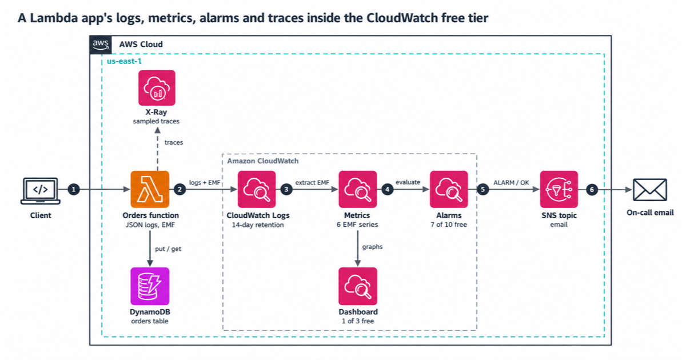

# Observability for a Lambda app inside the CloudWatch free tier

CloudWatch's always-free tier gives you 10 custom metrics, 10 alarm metrics, 5 GB of log ingestion, 5 GB of log storage and 3 dashboards a month. X-Ray adds 100,000 recorded traces. This repo is an AWS CDK construct, `FreeTierObservability`, that spends that budget on purpose. `cdk synth` fails when the custom metrics, alarms or dashboard would go over their free allowance. Logs, X-Ray and Lambda grow with traffic, so synth can't check them; `npm run estimate` does. The optional composite alarm costs $0.50 a month and still passes synth.

It wires a small orders function (AWS Lambda and Amazon DynamoDB) as the example, but the construct works for any Lambda function.

## Architecture



## What the construct sets up

| Piece | Setting | Why |
|---|---|---|
| Log group per function | 14-day retention, Standard class, created by the stack | Lambda's own log groups keep logs forever. EMF needs the Standard class |
| Lambda logging | JSON format, application level INFO, system level INFO | `console.debug` lines cost nothing until you lower the level |
| Custom metrics | Embedded metric format (EMF), from a catalog that lists every dimension value | The metric count is known before deploy: 6 series here |
| Alarms | 7 alarm metrics, all single-metric and standard resolution | 3 slots stay free for the next problem you find |
| Composite alarm | Off by default (`-c composite=true` turns it on) | It sends one email per incident, but costs $0.50 a month with no free tier |
| Dashboard | 1, with 13 metrics and an alarm status widget | A free dashboard may reference up to 50 metrics |
| Tracing | X-Ray active tracing, can be turned off | Lambda samples 1 request per second plus 5% of the rest, and you can't change that |
| Notifications | One Amazon SNS topic with an email subscription | The first 1,000 email notifications a month are free |

## The checks that fail synth

`FreeTierObservability` adds a validation to the stack. `cdk synth` stops with a message when any of these is true:

- more than 10 alarm metrics, counted the way CloudWatch bills them (a math expression over 3 metrics counts as 3)
- an alarm the free tier doesn't cover: a period under 60 seconds (high resolution), or a Metrics Insights query (`SELECT ...`), which bills per metric it analyzes
- more than 10 custom metric series in the catalog
- a catalog dimension named like a per-request value (`requestId`, `orderId`, `userId` and similar), or with more than 5 values
- an application log level of WARN or higher while the app publishes EMF metrics, because Lambda treats an EMF line with no `level` as INFO and drops it
- more than 50 metrics on the dashboard

## Estimate your own month

```bash
npm run estimate
npm run estimate -- --requestsPerMonth=5000000 --systemBytesPerRequest=0 --tracing=false
npm run estimate -- --customMetricSeries=1000000 --customMetricHoursPerMonth=1
```

The defaults describe this app: about 1,370 log bytes per request. At that size, log ingestion passes the free 5 GB at about 3.6 million requests a month. Lambda's own 1 million free requests run out first, and X-Ray tracing can bill above 100,000 requests. [docs/cost.md](docs/cost.md) walks through the numbers.

## Deploy

You need Node.js 24, AWS credentials, and a CDK-bootstrapped account.

```bash
npm ci
npm run check                                   # type check, lint, tests, synth with cdk-nag
npm run deploy -- -c alertEmail=you@example.com
npm run smoke                                   # invokes the function, waits for the EMF metrics
```

Confirm the subscription email from AWS, or alarms have nowhere to go.

Optional context flags: `-c composite=true` adds the composite alarm, and `-c heartbeat=true` adds an alarm for 24 hours with no orders. The heartbeat is off by default because an idle demo would trip it every day.

## Tests

| Command | What runs | Needs |
|---|---|---|
| `npm test` | Unit tests (EMF writer, estimator, handler), CDK template tests, cdk-nag, bundle checks | Nothing |
| `npm run test:int` | The real bundle against DynamoDB Local, including 20 concurrent creates of one order | Docker |
| `npm run smoke` | Checks against your deployed stack | A deploy |

To run the integration tests on your machine:

```bash
docker run -d --rm -p 8016:8000 amazon/dynamodb-local:3.3.2
AWS_ENDPOINT_URL_DYNAMODB=http://localhost:8016 npm run test:int
```

We broke each safeguard once to confirm a test fails: a `requestId` dimension, a log group without retention, an 11th alarm metric, EMF through `console.log`, the log level guard, and the DynamoDB condition.

## More docs

- [docs/cost.md](docs/cost.md): the free allowances, the prices after them, and where this app starts to pay
- [docs/runbook.md](docs/runbook.md): what to do when each alarm fires
- [docs/security.md](docs/security.md): permissions, and what we chose not to add

## Clean up

```bash
npm run destroy
```

The stack deletes the table and the log group with it. Delete anything you created by hand.

---

Created by Rahul Ladumor / InfraTales, under the MIT-0 license
